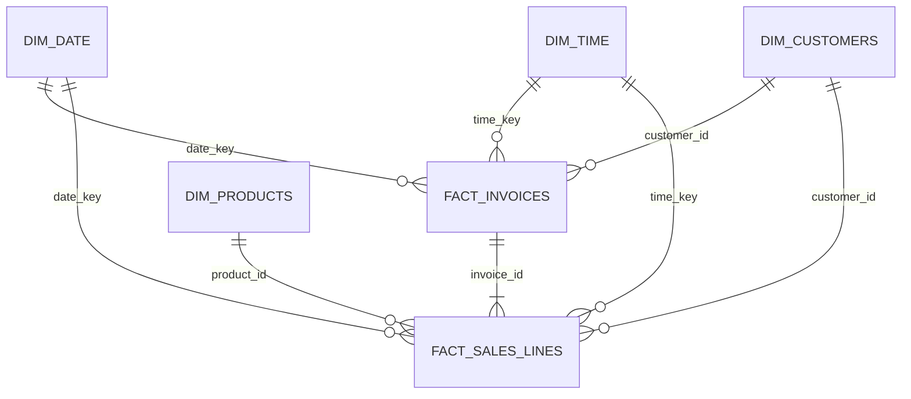

# Retail analytics pipeline: dbt + Snowflake

An end-to-end analytics engineering project built on point-of-sale (POS) exports from a family-run dry fruits and festival gift box retailer. Sales run through a POS system whose only analysis option was exporting messy CSV reports. This project turns those exports into clean, tested tables that answer business questions such as monthly sales, the festival-season spike, category mix, gift boxes vs loose products, busiest hours, and payment mix.

**Stack:** Snowflake (warehouse) · dbt platform (Fusion engine) · GitHub (version control, pull requests)

> **Data privacy:** this repository contains code only. Source data, business figures and customer details are kept private. Customer names, phone numbers, addresses and tax IDs are dropped in the staging layer.

---

## Architecture

```
POS exports (CSV)
        │  loaded as-is
        ▼
Bronze ── RAW.SALES_INVOICES, RAW.SALES_ITEMS        (dbt sources)
        │  rename, cast types, drop PII
        ▼
Silver ── stg_sales_invoices, stg_sales_items         (views)
        │  join, deduplicate, standardize, model
        ▼
Gold ──── dim_products, dim_customers, dim_date, dim_time,
          fact_invoices, fact_sales_lines             (tables, star schema)
          + festival_dates seed (reference data)
```

<!-- Add a lineage screenshot from dbt Catalog here (model names only, no data) -->
<!--  -->

### Data model (star schema)



| Layer | Model | Grain | What it does |
|---|---|---|---|
| Bronze | `raw.sales_invoices` | one row per bill | bill-level POS export, loaded as-is |
| Bronze | `raw.sales_items` | one row per product line | line-level POS export, loaded as-is |
| Silver | `stg_sales_invoices` | one row per bill | snake_case names, typed amounts, PII removed, walk-in flag |
| Silver | `stg_sales_items` | one row per product line | typed quantities and prices, 12-hour time parsed, line numbers added |
| Gold | `dim_products` | one row per product | standardized categories, latest price, gift box flag |
| Gold | `dim_customers` | one row per customer | Walk-in / B2B / Named retail, first and last purchase |
| Gold | `dim_date` | one row per day | calendar and Indian fiscal year (Apr–Mar) side by side, festival periods from a seed |
| Gold | `dim_time` | one row per minute | hour labels and day parts for time-of-day analysis |
| Gold | `fact_invoices` | one row per bill | totals, tax, payment split, bill time, line counts |
| Gold | `fact_sales_lines` | one row per product line | quantity, price, discount, tax, line total |
| Seed | `festival_dates` | one row per festival period | shopping-rush windows (Dussehra, Diwali, Sankranti), with an `is_confirmed` flag for provisional dates |

---

## Design decisions

- **Two calendars in one date dimension:** the owners think in calendar months; the accountant works in the Indian fiscal year (April–March). `dim_date` carries both, so every report uses the same facts and the numbers always tie out.
- **Festival periods as reference data:** festival windows live in a seed, not in SQL, so they can be updated without code changes. Unconfirmed dates are flagged rather than presented as fact.
- **Integer date and time keys:** `date_key` (YYYYMMDD) and `time_key` (HHMM) are readable at a glance and join consistently across facts.
- **Time zones:** POS timestamps are recorded in local store time with no time zone, so no conversion is applied. "Current month" metrics use the latest date in the data rather than the warehouse clock, which runs on a different time zone.

## Data quality issues I found and how I handled them

| Issue in the source | Why it matters | Fix |
|---|---|---|
| Bill numbers repeat: retail bills and B2B invoices use separate numbering | Joining or counting on bill number alone silently mixes up different bills | Use the POS `invoice_id` as the key; join items to bills on `voucher_type + voucher_number`, tested unique |
| Line export has no line ID, and the same product can appear twice on one bill | No natural primary key for sales lines | `row_number()` per bill creates `line_number` |
| Blank values in numeric columns broke the warehouse load | A single blank fails a numeric cast | Cast in staging with `try_to_number`, so blanks become NULL instead of errors |
| Inconsistent product categories (`Snack` vs `Snacks`, nested category paths, nulls) | Category reports split the same products | Explicit mapping in `dim_products`; nulls become `Uncategorized` |
| Prices change over time for over half of products | Which price is "the" price? | `dim_products` keeps the latest; facts keep the price actually charged |
| B2B invoices leave net/subtotal/paid blank | Revenue undercounted if those columns are used | `total_amount` / `line_total` are the revenue measures |
| Bill time exists only on line items | Time-of-day analysis needs a time per bill | `fact_invoices` takes the bill time from its lines; bills without line detail have no time |

## Tests

`dbt build` runs 27 tests on every build:
- **Keys:** `unique` + `not_null` on every primary key, including the date and time dimensions
- **Referential integrity:** every fact row points to an existing product, customer, bill, date and time (`relationships`)
- **Accepted values:** voucher types and customer types
- **Calendar safety:** `date_day` is unique in `dim_date`, so overlapping festival windows can never duplicate days and double-count sales
- **Reconciliation:** `tests/assert_gold_totals_match_raw.sql` checks that gold-layer sales totals match the raw source totals within 1 unit, so no rows are lost or duplicated in transformation. Gold totals were also verified once against the POS system's own report.

## Known limitations

- **No margin analysis:** purchase cost is rarely recorded in the POS.
- **No inventory analysis:** stock data in the POS is incomplete.
- **No employee dimension:** a single salesperson and counter, so a staff dimension would add nothing.
- **Customer analysis is limited:** almost all bills are walk-in customers sharing one POS ID. Repeat-customer metrics only cover named and B2B customers.
- **Different date ranges:** line-level detail (products, time of day) covers a shorter period than bill-level data. `fact_invoices.has_line_detail` flags which bills have line items.
- **Festival windows are provisional** until confirmed by the business (`festival_dates.is_confirmed`).

## What's next

- Dashboard on the gold tables: monthly trend, festival spike, top products, busiest hours, payment mix
- Customer ledger for credit sales, and GST summaries by HSN code and fiscal period
- Add the store's gift box web app order log as a second source
- Festival-season sales forecast